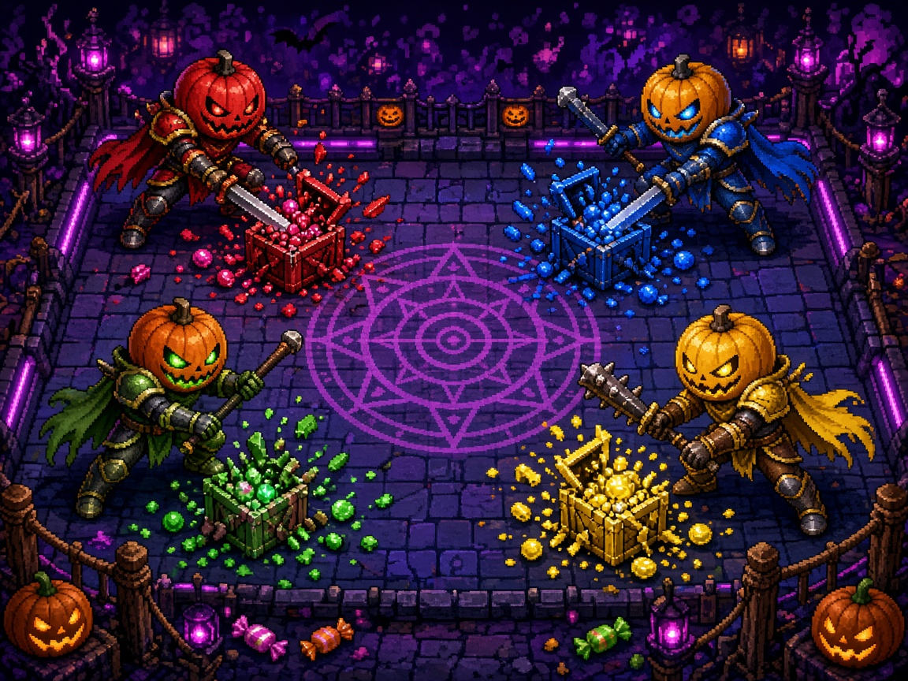

# Pumpkin Panic Arena

Four pumpkin knights share one arena and one pile of candy. Smash the crates, bash the other knights, and don't get caught holding nothing.

It's a local 4-player free-for-all in the browser: one keyboard, up to four gamepads, no accounts, and no network once the page is open.

## Launch

Python 3 is the only requirement. There is no install step and no build. The launcher starts a tiny server on `127.0.0.1` and opens the game. The preferred port is **8801** (from `arcade.json`). If that port is busy, the next free port is used.

### macOS

Double-click `launch-mac.command`. If macOS blocks it, right-click the file, choose Open, and confirm. Or from Terminal:

```bash
./launch-mac.command
```

### Windows

Double-click `launch-windows.bat`.

### Linux

```bash
chmod +x launch-linux.sh
./launch-linux.sh
```

### From a terminal on any OS

```bash
python3 server.py
```

Add `--no-browser` to serve without opening a window, or `--port 9000` to prefer a different port.

Open the printed URL. Loading `index.html` as a file will not work: the game is an ES module and needs the local server.

If Python 3 is missing, the launcher says so instead of failing silently.

## How a match starts

1. Title screen. Press **Enter** or a gamepad **Start**. **Esc** opens settings.
2. Join screen. Every slot begins as a **bot**. Press your **bash** key (or gamepad **A**) to play that slot yourself. Press **charge** (or **B**) to cycle Bot → Off → Bot. **Enter** or **Start** begins when at least one knight is in.
3. A three-second countdown, then a 90-second round.

**M** mutes the synthesized soundtrack. Volume, the number of rounds, and keyboard binds are in Settings and are saved in `localStorage`.

## Controls

Keyboard works with no gamepads. A connected gamepad occupies that player slot (pad 0 is P1 through pad 3 is P4) and overrides that player's keys until it is unplugged. The HUD shows a pad icon while it is connected. Pads can be plugged in mid-match.

| Player | Move | Bash | Charge |
| --- | --- | --- | --- |
| P1 | W A S D | F | G |
| P2 | Arrow keys | / | . |
| P3 | I J K L | ; | ' |
| P4 | Numpad 8 4 5 6 | Numpad 0 | Numpad Enter |
| Gamepad | Left stick or D-pad | A | B |

**Start** pauses and resumes. **Esc** pauses during a round and backs out of menus. On the match-end screen, **Enter** or **Start** rematches and **Esc** returns to the title.

Bash is the action. Charge is the secondary: a short dash that can smash whatever you run through. Both are remappable from Pause → Settings → Controls. Gamepad buttons stay on the standard layout.

## Rules

The arena is top-down. Candy crates appear through the round. **Bash** or **charge** into a crate to break it. Broken crates spill candy onto the floor. Walk over candy to pocket it.

Bash another knight and some of their candy scatters for anyone to grab. A knight who is **hit while holding zero candy** is knocked out for the rest of the round. Armor (Caramel Coat) blocks both the spill and the knockout.

The round lasts **90 seconds**. It ends early when only one knight is still standing (and at least two started the round). A solo knight with the others set to Off plays the timer out.

## Scoring

- Candy in your pocket is the round score. It resets every round.
- When the timer expires, the knight with the **most candy** wins the round. A tie is a draw and nobody scores it.
- The last knight standing wins the round even if their pocket is empty.
- Each round win is one point. First to **3** round wins takes the match. Change that from 1 to 9 in Settings.
- The match screen lists the standings. Rematch keeps the same humans and bots.

### Power-ups

These float into the arena during a round:

| Pickup | Effect |
| --- | --- |
| Sugar Rush | Move faster for a few seconds |
| Caramel Coat | Candy can't be knocked loose and you can't be KO'd |
| Taffy Pull | Nearby candy is pulled toward you |
| Gummy Blast | Your next bash is bigger and knocks more candy loose |

Bots fill any slot that isn't a human, so one person can play against the house. They chase candy and crates, and they only pick fights once they have candy of their own.

## Audio

Hits, pickups, knockouts, the countdown, round wins, and a short looping chiptune are synthesized in the browser with the Web Audio API. There are no audio files. The first key press or click starts the sound, which browsers require.

## arcade.json

The root `arcade.json` manifest is what an arcade launcher reads:

| Field | Value |
| --- | --- |
| `name` | Pumpkin Panic Arena |
| `id` | `pumpkinpanicarena` |
| `icon` / `cover` | `assets/icon.jpg`, `assets/cover.jpg` |
| `launch` | mac, windows, and linux scripts, plus `index.html` |
| `players` | 4 (minimum 1) |
| `port` | 8801 |
| `input` | keyboard, gamepad |
| `version` | 1.0.0 |

## Tests

Core rules live in `src/core/` with no DOM, so they run in Node. Rendering, keyboard and gamepad polling, and audio live in `src/ui/`. The simulation steps at a fixed 60 Hz; drawing is separate.

```bash
node --test tests/
python3 tests/smoke_server.py
```

`node --test` covers movement and collision, scoring, round and match wins, elimination, the four power-ups and the charge, seeded RNG determinism, keyboard and gamepad mapping, and checks that `arcade.json` points at files that exist. The Python smoke test launches `server.py` without a browser, fetches the page, and checks that a busy port falls forward.

GitHub Actions runs both on every push and pull request.

## Project layout

```
index.html              canvas shell
server.py               local static server
launch-mac.command      macOS launcher
launch-windows.bat      Windows launcher
launch-linux.sh         Linux launcher
arcade.json             arcade launcher manifest
src/core/               rules, input mapping, RNG, bots
src/ui/                 drawing, browser input, synthesized audio
src/main.js             60 Hz loop
tests/                  node:test suite and server smoke test
assets/                 cover and icon
```

Random crate drops, candy scatters, and power-up spawns all come from a seeded generator. The same seed and the same inputs replay the same match.

## License

MIT. See [LICENSE](LICENSE).
